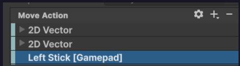
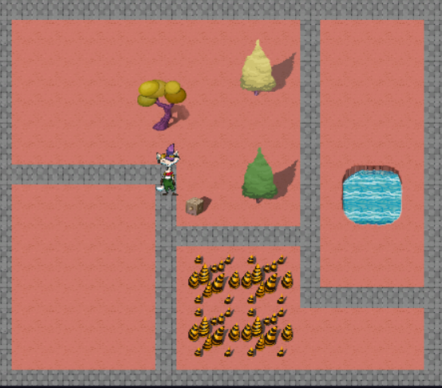

# Robot Repair — Токарчук Любомир
Навчальний проєкт з дисципліни «Геймдизайн та програмування ігрових застосунків». РФКІТ, група КН-3/1, 2026/27.
## Проєкт
Adventure Game: Robot Repair (Unity Technologies), Unity 6.3, URP.
## Як запустити
Відкрити теку проєкту через Unity Hub, редактор 6.3, відкрити сцену рівня, натиснути Play.
## Що зроблено
• Заняття 3: проєкт запущено, перемкнуто набір артів

# __Щоденник розробника:__
### __17.09.2026__ - Юніт 1: персонаж і рух
* __Що зроблено:__ Створив сцену MainScene, додав персонажа та скрипт PlayerController. Налаштував рух персонажа за стрілками та WASD. Створив Tilemap і намалював підлогу за допомогою Tile Palette.
* __Що не вийшло або забрало найбільше часу:__ Найбільше часу забрало створення підлоги, налаштування руху персонажа та перевірка роботи клавіш.
* __Що зрозумів про Update і Time.deltaTime:__ Зрозумів, що Update виконується багато разів під час роботи гри, а Time.deltaTime потрібен для того, щоб швидкість руху не залежала від кількості кадрів за секунду.
* __Що робитиму далі:__ Запишу коротке відео роботи гри та підготую репозиторій до здачі і зроблю "More things to try":
### Gamepad Left Stick: 
### Plan your environment: 

### __24.09.2026__ - Юніт 2: оточення і фізика
* __Що зроблено:__ Додав фізику для персонажа, Rigidbody 2D та Collider 2D. Налаштував зіткнення персонажа з об'єктами рівня та почав працювати з Tilemap Collider 2D.
* __Що не вийшло або забрало найбільше часу:__ Найбільше часу забрало налаштування колайдерів тайлів. Спочатку робот почав відштовхуватися від підлоги після додавання Tilemap Collider 2D.
* __Що зрозумів про FixedUpdate і колайдери:__ FixedUpdate використовується для роботи з фізикою. Колайдери потрібні для визначення зіткнень між об'єктами.
* __Що в рівні вийшло не так, як у фізичному паспорті, і чому:__ Після додавання Tilemap Collider 2D робот почав виштовхуватися з місця. Потрібно правильно налаштувати колайдери тайлів, щоб підлога не заважала руху персонажа.
* __Що робитиму далі:__ Завершу налаштування колайдерів тайлів, перевірю зіткнення з декораціями та протестую рух персонажа по рівню.

### __30.09.2026__ - Юніт 3: система здоров'я
* __Що зроблено:__ Додав систему здоров'я для гравця, аптечки та зони шкоди. Реалізував втрату та відновлення здоров'я, а також невразливість після отримання шкоди. Додав інший спрайт аптечки.
* __Що не вийшло або забрало найбільше часу:__ Найбільше часу забрало налаштування тригерів та пошук помилки з колайдером аптечки.
* __Що зрозумів про FixedUpdate і колайдери:__ Тригер дозволяє об'єктам проходити крізь нього, але повідомляє про взаємодію об'єктів. public дозволяє звертатися до поля з інших класів, а private використовується тільки всередині самого класу.
* __Що в рівні вийшло не так, як у фізичному паспорті, і чому:__ Обрав Time Invincible = 1.3 секунди для гравця, щоб після отримання шкоди він мав час вийти із небезпечної зони.
* __Що робитиму далі:__ Спробую зробити More things to try

### 09.10.2026 — Юніт 4: вороги і снаряди

* **Що зроблено:** Додав ворогів, анімації, стрільбу снарядами та ремонт ворогів після влучання. Реалізував знищення снарядів і обмеження темпу пострілів.

* **Що не вийшло або забрало найбільше часу:** Найбільше часу забрало налаштування Animator і шарів фізики.

* **Що зрозумів про Animator, шари й Awake:** Animator керує анімаціями, шари налаштовують взаємодію об’єктів, а Awake використовується для початкової ініціалізації снаряда.

* **Які Speed і Change Time обрав:** Для повільного ворога — 0.4, для швидкого — 1, Change Time — 3 секунди.

* **Що робить мій снаряд з ворогом:** При влучанні снаряд ремонтує ворога, після чого той зупиняється й більше не шкодить роботу.

* **Що робитиму далі:** Детально перевірю всі етапи проєкту.

### 16.10.2026 — Юніт 5: HUD, діалоги, ігровий цикл

* **Що зроблено:** Додав смугу здоров’я гравця, діалог із NPC, бульбашку з позначкою X, екрани перемоги й поразки. Реалізував перевірку умов завершення гри та перезапуск рівня через 4 секунди.
* **Що не вийшло або забрало найбільше часу:** Найбільше часу зайняло налаштування і виправлення помилок.
* **Що зрозумів про UI Toolkit, синглтон і raycast:** UI Toolkit використовується для створення інтерфейсу гри. `UIHandler.instance` дає змогу звертатися до одного екземпляра `UIHandler` з інших скриптів. Raycast дає змогу перевірити, чи знаходиться NPC перед гравцем.
* **Що каже мій NPC і чому саме це:** NPC пояснює мету ремонту роботів і допомагає гравцеві зрозуміти, що потрібно робити в грі.
* **Умови перемоги й поразки в моєму зрізі:** Перемога настає, коли всі роботи відремонтовані, а поразка — коли здоров’я гравця падає до нуля. Після показу відповідного екрана через 3 секунди рівень перезапускається.
 **Що робитиму далі:** Завершу додаткові завдання, перевірю роботу всіх механік, зроблю запис екрана та підготую проєкт до здачі.

* **More things to try** Перевірив розташування елементів HUD відповідно до паперового макета з домашнього завдання до лекції № 9. Показав інтерфейс людині, яка не брала участі в розробці, щоб перевірити його читабельність і зрозумілість.

